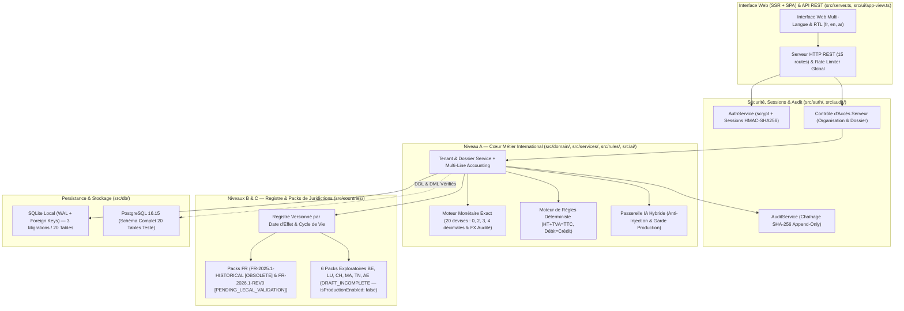

# ARCHITECTURE TECHNIQUE DÉTAILLÉE (`ARCHITECTURE.md`) — ComptaNova

Ce document décrit l'architecture technique consolidée et vérifiée sur le code réel de `src/` à l'issue de l'audit indépendant de clôture de la Phase 0.

---

## 1. Vue d'Ensemble et Séparation en 3 Niveaux

---

## 2. Responsabilités des Modules (`src/`)

| Module / Fichier | Niveau | Responsabilités vérifiées dans le code |
| :--- | :--- | :--- |
| [`src/config/app-config.ts`](../src/config/app-config.ts) | Transverse | Centralisation du nom du produit (`APP_NAME` $\rightarrow$ `appConfig.appName`), des variables `.env` et des paramètres serveur/IA/stockage. *(Note d'audit `SEC-OPEN-01` : doit être durci pour refuser `defaultDevSecret` en `NODE_ENV=production`)*. |
| [`src/domain/money.ts`](../src/domain/money.ts) | Niveau A | Arithmétique monétaire entière (`BigInt`) sans flottants binaires, **20 devises** enregistrées à `0`, `2`, `3` et `4` décimales, 4 modes d'arrondi, conversions FX auditées (`convertCurrencyWithAudit`) et écarts de change (`computeRealizedExchangeDifference`). |
| [`src/domain/types.ts`](../src/domain/types.ts) | Niveau A | Types métier internationaux (rôles, statuts de validation, entités juridiques, factures, écritures, pistes d'audit). |
| [`src/countries/country-registry.ts`](../src/countries/country-registry.ts) | Niveaux B & C | Modèle de configuration par juridiction versionné par dates d'effet, machine à états et **8 versions couvrant 7 pays** (`FR` [2 versions], `BE`, `LU`, `CH`, `MA`, `TN`, `AE`). |
| [`src/rules/deterministic-engine.ts`](../src/rules/deterministic-engine.ts) | Niveau A | Contrôles déterministes d'intégrité ($\text{HT} + \text{TVA} = \text{TTC}$, cohérence taux en bps, équilibre Débit = Crédit) et simulations indicatives (`runDeterministicSimulation`). |
| [`src/ai/ai-gateway.ts`](../src/ai/ai-gateway.ts) | Niveau A | Interface `AiProviderAdapter`, isolation anti-prompt injection (`inspectAndIsolateUntrustedContent`), interdiction d'auto-validation (`enforceHumanValidationRequirement`) et garde de production (`assertAiProviderAllowedForEnvironment`). |
| [`src/auth/auth-service.ts`](../src/auth/auth-service.ts) | Sécurité | Hachage `scrypt`, sessions serveur `HMAC-SHA256`, gardes `assertOrganizationAccess` (justification `PLATFORM_ADMIN` $\ge 10$ caractères) / `assertDossierAccess`, et jetons signés `generateSignedDocumentDownloadToken` / `verifySignedDocumentDownloadToken`. |
| [`src/audit/audit-service.ts`](../src/audit/audit-service.ts) | Sécurité | Enregistrement dans `audit_logs` avec chaînage `SHA-256` et vérification `verifyAuditChainIntegrity()`. |
| [`src/db/database.ts`](../src/db/database.ts) & [`src/db/phase1-readiness-migration.ts`](../src/db/phase1-readiness-migration.ts) | Persistance | Moteur de migrations transactionnelles (`001`, `002`, `003`), **20 tables métier** compatibles SQLite et PostgreSQL 16, et fonction `recordMultiLineAccountingEntry()`. |
| [`src/services/tenant-service.ts`](../src/services/tenant-service.ts) | Niveau A | Gestion des organisations, membres, dossiers, affectations par dossier, ingestion de métadonnées documentaires (`ingestDocumentIntoDossier`) et métriques du tableau de bord. |
| [`src/i18n/translations.ts`](../src/i18n/translations.ts) & [`src/ui/app-view.ts`](../src/ui/app-view.ts) | Interface | Dictionnaires `fr`, `en`, `ar` (RTL), formatage localisé et rendu HTML de l'interface web initiale. |
| [`src/server.ts`](../src/server.ts) | API & HTTP | Serveur HTTP REST exposant les 15 routes listées en Section 4 ci-dessous. |

---

## 3. Schéma de Base de Données Relationnelle (20 Tables Métier)

### 3.1. Tables du Socle Phase 0 & Extension Internationale (Migrations `001` & `002` — 12 tables)
1. `country_config_versions`
2. `organizations`
3. `users`
4. `organization_memberships`
5. `auth_sessions`
6. `client_dossiers`
7. `dossier_assignments`
8. `documents`
9. `invoices`
10. `accounting_entries`
11. `simulations_history`
12. `audit_logs`

### 3.2. Tables Préparatoires de la Phase 1 (Migration `003` — 8 tables)
13. `third_parties`
14. `chart_of_accounts`
15. `accounting_journals`
16. `accounting_entry_lines`
17. `import_batches`
18. `bank_transactions`
19. `reconciliation_links`
20. `anomalies`

---

## 4. Endpoints API REST Réellement Exposés dans [`src/server.ts`](../src/server.ts) (15 Routes)

| Méthode & Route | Contrôle d'accès actuel dans `src/server.ts` | Description |
| :--- | :--- | :--- |
| `GET /` | Publique | Interface web initiale (`?lang=fr`, `?lang=en`, `?lang=ar` avec `dir="rtl"`). |
| `GET /api/health` | Publique | État du serveur, `productName`, `auditChainIntact` (`verifyAuditChainIntegrity`) et disclaimer réglementaire. |
| `POST /api/auth/login` | Publique | Authentification `email`/`password` et émission d'un jeton de session signé `HMAC-SHA256`. |
| `POST /api/auth/logout` | Jeton optionnel | Révocation de la session active (`revokeSession`). |
| `GET /api/auth/me` | Authentifié (`Bearer`) | Contexte de session de l'utilisateur et organisations accessibles. |
| `GET /api/countries` | Authentifié (`Bearer`) | Liste des configurations de juridictions (`?includeHistorical=true` optionnel). |
| `GET /api/organizations` | Authentifié (`Bearer`) | Liste des organisations auxquelles appartient l'utilisateur. |
| `POST /api/organizations` | Authentifié (`Bearer`) | Création d'une nouvelle organisation multi-juridiction / multi-devise. |
| `GET /api/organizations/:orgId/dashboard` | Membre de `orgId` (ou `PLATFORM_ADMIN` justifié) | Métriques réelles de l'organisation (dossiers, membres, documents, écritures, événements d'audit). |
| `GET /api/organizations/:orgId/members` | Membre de `orgId` (ou `PLATFORM_ADMIN` justifié) | Liste des membres et rôles de l'organisation. |
| `POST /api/organizations/:orgId/members` | `FIRM_ADMIN` sur `orgId` | Ajout d'un collaborateur ou membre dans l'organisation. |
| `GET /api/organizations/:orgId/dossiers` | Membre de `orgId` (filtré selon `dossier_assignments`) | Liste des dossiers accessibles à l'utilisateur dans l'organisation. |
| `POST /api/organizations/:orgId/dossiers` | `FIRM_ADMIN` sur `orgId` | Création d'un dossier client rattaché à une juridiction et une devise. |
| `GET /api/organizations/:orgId/audit-logs` | Membre de `orgId` *(Note `SEC-OPEN-02` : à restreindre à `FIRM_ADMIN`)* | 50 derniers événements d'audit de l'organisation et état d'intégrité de la chaîne `SHA-256`. |
| `POST /api/organizations/:orgId/simulate` | Membre de `orgId` | Exécution d'une simulation déterministe (`VAT_SUMMARY` ou `SOCIAL_CONTRIBUTIONS`) avec avertissement indicatif. |
