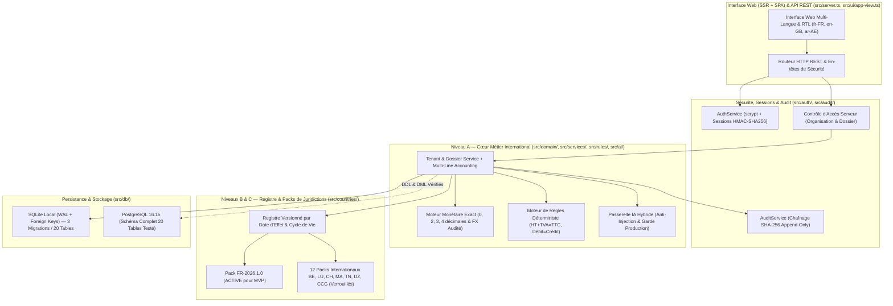

# ARCHITECTURE TECHNIQUE DÉTAILLÉE (`ARCHITECTURE.md`) — ComptaNova

Ce document décrit l'architecture technique consolidée à l'issue de la Phase 0 (incluant l'extension internationale et le schéma préparatoire de la Phase 1).

---

## 1. Vue d'Ensemble et Séparation en 3 Niveaux

---

## 2. Responsabilités des Modules (`src/`)

| Module / Fichier | Niveau | Responsabilités principales |
| :--- | :--- | :--- |
| [`src/config/app-config.ts`](../src/config/app-config.ts) | Transverse | Centralisation du nom du produit (`ComptaNova`), des variables d'environnement, des secrets de session/URL signées et des jetons de couleurs. |
| [`src/domain/money.ts`](../src/domain/money.ts) | Niveau A | Arithmétique monétaire entière (`BigInt`) sans flottants binaires, catalogue de devises à `0`, `2`, `3` et `4` décimales, 4 modes d'arrondi, conversions FX auditées et écarts de change. |
| [`src/domain/types.ts`](../src/domain/types.ts) | Niveau A | Types métier internationaux (rôles, statuts de validation, entités juridiques, factures, écritures, pistes d'audit). |
| [`src/countries/country-registry.ts`](../src/countries/country-registry.ts) | Niveaux B & C | Modèle de configuration par juridiction versionné par dates d'effet, machine à états (`DRAFT`, `IN_REVIEW`, `VALIDATED`, `ACTIVE`, `SUSPENDED`, `OBSOLETE`) et 13 packs pays. |
| [`src/rules/deterministic-engine.ts`](../src/rules/deterministic-engine.ts) | Niveau A | Contrôles déterministes d'intégrité ($\text{HT} + \text{TVA} = \text{TTC}$, cohérence taux en bps, équilibre Débit = Crédit) et simulations indicatives horodatées. |
| [`src/ai/ai-gateway.ts`](../src/ai/ai-gateway.ts) | Niveau A | Interface `AiProviderAdapter`, isolation anti-prompt injection (`inspectAndIsolateUntrustedContent`), interdiction d'auto-validation (`enforceHumanValidationRequirement`) et garde de production (`assertAiProviderAllowedForEnvironment`). |
| [`src/auth/auth-service.ts`](../src/auth/auth-service.ts) | Sécurité | Hachage `scrypt`, sessions serveur `HMAC-SHA256`, gardes `assertOrganizationAccess` / `assertDossierAccess`, jetons de téléchargement signés. |
| [`src/audit/audit-service.ts`](../src/audit/audit-service.ts) | Sécurité | Enregistrement append-only dans `audit_logs` avec chaînage `SHA-256` et vérification `verifyAuditChainIntegrity()`. |
| [`src/db/database.ts`](../src/db/database.ts) & [`src/db/phase1-readiness-migration.ts`](../src/db/phase1-readiness-migration.ts) | Persistance | Moteur de migrations transactionnelles (`001`, `002`, `003`), 20 tables métier compatibles SQLite et PostgreSQL 16, et fonction `recordMultiLineAccountingEntry()`. |
| [`src/services/tenant-service.ts`](../src/services/tenant-service.ts) | Niveau A | Création et lecture d'organisations, membres, dossiers, ingestion documentaire, affectations par dossier et métriques du tableau de bord. |
| [`src/i18n/translations.ts`](../src/i18n/translations.ts) & [`src/ui/app-view.ts`](../src/ui/app-view.ts) | Interface | Dictionnaires `fr-FR`, `en-GB`, `ar-AE` (RTL), formatage localisé et rendu de l'interface web initiale. |
| [`src/server.ts`](../src/server.ts) | API & HTTP | Serveur HTTP REST exposant `/api/health`, `/api/auth/login`, `/api/countries`, `/api/i18n`, `/api/organizations`, `/api/dossiers/...`, `/api/audit/verify` et `/`. |

---

## 3. Schéma de Base de Données Relationnelle (20 Tables Métier)

### 3.1. Tables du Socle Phase 0 & Extension Internationale (Migrations `001` & `002` — 12 tables)
1. **`country_config_versions`** : Versions datées des configurations réglementaires par juridiction.
2. **`organizations`** : Organisations clientes (cabinets comptables, sociétés, indépendants) avec pays d'établissement, juridiction fiscale principale, devise et quotas.
3. **`users`** : Utilisateurs de la plateforme (`email`, `password_hash` scrypt, `is_platform_admin`).
4. **`organization_memberships`** : Adhésions et rôles (`PLATFORM_ADMIN`, `FIRM_ADMIN`, `ACCOUNTANT_COLLABORATOR`, `CLIENT_DIRECTOR`) par organisation.
5. **`auth_sessions`** : Sessions actives signées et révocables (`token_hash`, `active_organization_id`, `expires_at`, `revoked_at`).
6. **`client_dossiers`** : Dossiers comptables rattachés à une organisation, une juridiction fiscale, une version de règles et une devise avec `currency_minor_unit_exponent`.
7. **`dossier_assignments`** : Droits granulaires d'un utilisateur sur un dossier (`can_view`, `can_upload`, `can_edit_extraction`, `can_validate_accounting`, `can_export`).
8. **`documents`** : Pièces justificatives avec empreinte `sha256_checksum`, clé de stockage privée, statut de workflow, données extraites et `retention_until_date`.
9. **`invoices`** : Factures émises, reçues et avoirs en unités mineures (`net_amount_minor`, `vat_amount_minor`, `gross_amount_minor`), devise, audit de change et statut de validation.
10. **`accounting_entries`** : En-têtes d'écritures comptables avec `total_debit_minor`, `total_credit_minor`, journal, pièce, devise et référence à la version de règle.
11. **`simulations_history`** : Historique horodaté des simulations indicatives avec paramètres, hypothèses, limites et avertissement légal.
12. **`audit_logs`** : Journal d'audit applicatif chaîné par `SHA-256` (`previous_hash`, `integrity_hash`).

### 3.2. Tables Préparatoires de la Phase 1 (Migration `003` — 8 tables)
13. **`third_parties`** : Clients et fournisseurs par dossier (pays, juridiction fiscale, SIREN/TVA, compte auxiliaire).
14. **`chart_of_accounts`** : Plan comptable par dossier.
15. **`accounting_journals`** : Journaux comptables (`AC`, `VT`, `BQ`, `OD`, `AN`) par dossier.
16. **`accounting_entry_lines`** : Lignes d'écritures comptables multi-lignes avec contrainte `CHECK (NOT (debit_minor > 0 AND credit_minor > 0))` et validation transactionnelle $\sum \text{Débit} = \sum \text{Crédit}$.
17. **`import_batches`** : Lots d'import (factures CSV/Excel, relevés bancaires CSV/OFX) avec empreinte `file_sha256_checksum` d'idempotence et rapport d'erreurs.
18. **`bank_transactions`** : Opérations bancaires normalisées avec `UNIQUE(dossier_id, external_dedup_hash)`.
19. **`reconciliation_links`** : Liens de rapprochement bancaire supportant les paiements partiels (`allocated_amount_minor`) et la validation humaine obligatoire.
20. **`anomalies`** : Anomalies détectées distinguant erreur certaine (`is_certain_error = 1`) et suspicion à vérifier (`is_certain_error = 0`).

---

## 4. Endpoints API REST Disponibles en Phase 0

| Méthode & Route | Authentification | Description |
| :--- | :--- | :--- |
| `GET /` | Publique | Interface web initiale (`?lang=fr-FR`, `?lang=en-GB`, `?lang=ar-AE` avec support RTL). |
| `GET /api/health` | Publique | État du serveur, nom du produit configuré et statut d'intégrité de la chaîne d'audit SHA-256. |
| `GET /api/countries` | Publique | Liste des 13 configurations de juridictions versionnées et de leurs statuts de validation. |
| `GET /api/i18n?locale=...` | Publique | Descripteur de locale (`direction: ltr|rtl`) et dictionnaire de traduction. |
| `POST /api/auth/login` | Publique | Authentification `email`/`password` et émission d'un jeton de session signé `HMAC-SHA256`. |
| `GET /api/organizations` | Requise (`Bearer`) | Liste des organisations auxquelles appartient l'utilisateur connecté. |
| `POST /api/organizations` | Requise (`Bearer`) | Création d'une nouvelle organisation multi-juridiction / multi-devise. |
| `GET /api/organizations/:orgId/dashboard` | Requise (`Bearer` + accès org) | Métriques réelles de l'organisation (dossiers, membres, documents, écritures, événements d'audit). |
| `GET /api/organizations/:orgId/dossiers` | Requise (`Bearer` + accès org) | Liste des dossiers accessibles à l'utilisateur dans l'organisation. |
| `POST /api/organizations/:orgId/dossiers` | Requise (`FIRM_ADMIN`) | Création d'un dossier client rattaché à une juridiction et une devise. |
| `POST /api/organizations/:orgId/dossiers/:dossierId/documents` | Requise (`UPLOAD` sur dossier) | Ingestion d'un document, calcul `SHA-256`, extraction en mode proposition et journalisation d'audit. |
| `POST /api/organizations/:orgId/dossiers/:dossierId/simulations` | Requise (`VIEW` sur dossier) | Exécution d'une simulation déterministe sur une règle validée avec avertissement indicatif. |
| `GET /api/audit/verify` | Requise (`Bearer`) | Vérification cryptographique de la chaîne `SHA-256` du journal d'audit. |
