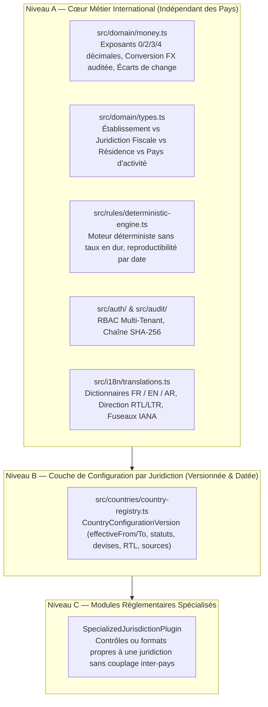

# Documentation d'Architecture — Socle International & Phase 0 Consolidée

## 1. Audit d'Architecture et Hypothèses Européennes Identifiées (Section 3)

Avant l'extension internationale, l'audit complet du code de la Phase 0 a mis en évidence **7 hypothèses implicites liées à l'Europe ou aux devises à deux décimales** qui auraient bloqué l'expansion vers le Maghreb, le Moyen-Orient (CCG), l'Afrique subsaharienne, les Amériques ou l'Asie-Pacifique :

1. **Modèle monétaire (`src/domain/money.ts`)** :
   - Le type `CurrencyCode` était restreint à 4 devises (`"EUR" | "CHF" | "USD" | "GBP"`), toutes configurées à **2 décimales** (`CURRENCY_DECIMALS = 2`).
   - Il ne gérait ni les devises à **0 décimale** (`XOF`, `XAF`, `JPY`), ni les devises à **3 décimales** (`TND` en Tunisie, `BHD` à Bahreïn, `OMR` à Oman, `KWD` au Koweït).
   - La structure `MonetaryAmount` ne transportait pas explicitement son exposant (`minorUnitExponent`).
   - L'arrondi fiscal était codé en dur en `HALF_UP` sans supporter `HALF_EVEN`, `FLOOR` ou `CEILING`.
   - Aucune fonction de conversion de devises avec piste d'audit (`ExchangeRateAuditRecord`) ni de calcul d'écart de change (`computeRealizedExchangeDifference`) n'existait.
2. **Types métier (`src/domain/types.ts`)** :
   - `Organization` et `ClientDossier` utilisaient un unique champ `countryCode` sans distinguer le **pays d'établissement**, la **juridiction fiscale applicable**, le **pays de résidence fiscale** et les **pays d'activité** (`operatingCountryCodes`).
3. **Moteur déterministe (`src/rules/deterministic-engine.ts`)** :
   - Contenait un fallback implicite français (`const rateBps = params.vatRateBps ?? 2000;`) à la ligne 201.
   - Supposait que toute juridiction applique une TVA, sans gérer les juridictions sans taxe indirecte (`indirectTaxSystem === "NONE"`).
4. **Registre des juridictions (`src/countries/country-registry.ts`)** :
   - Ne fournissait pas de mécanisme de résolution temporelle (`resolveJurisdictionConfigForDate`) ni d'interface formelle de plugins réglementaires spécialisés (Niveau C).
5. **Schéma SQL (`src/db/database.ts`)** :
   - La migration `001_phase0_foundations` contenait `CHECK (currency IN ('EUR', 'CHF', 'USD', 'GBP'))` sur `organizations`, `client_dossiers`, `invoices` et `accounting_entries`.
6. **Serveur API (`src/server.ts`)** :
   - Contenait des valeurs par défaut `"FR"` et `"FR_REEL_NORMAL_IS"` codées en dur lors de la création de dossiers.
7. **Interface utilisateur (`src/ui/app-view.ts`)** :
   - Était codée en `<html lang="fr">` sans support RTL (`dir="rtl"` pour l'arabe), avec des listes déroulantes HTML limitées à `FR`, `BE`, `LU`, `CH`.

---

## 2. Architecture Cible à 3 Niveaux (Section 2)



---

## 3. Exemple Documenté : Comment Ajouter une Nouvelle Juridiction (Section 9.7 & 10)

L'ajout d'une nouvelle juridiction (ou d'un nouveau millésime réglementaire) ne nécessite **aucune modification du cœur métier**. Voici un exemple complet d'enregistrement d'une juridiction fictive (`QA` ou `ZZ`) avec une devise spécifique et une période de validité :

```typescript
import { registerCurrencyDefinition } from "../src/domain/money.js";
import { registerCountryConfigurationVersion } from "../src/services/tenant-service.js";
import { CountryConfigurationVersion } from "../src/countries/country-registry.js";

// 1. Si la devise n'est pas encore au catalogue, déclarer sa précision ISO 4217 explicite (0, 2 ou 3 décimales)
registerCurrencyDefinition({
  code: "KWD",
  name: "Kuwaiti Dinar",
  symbol: "KWD",
  minorUnitExponent: 3, // 1 KWD = 1000 fils
});

// 2. Déclarer la version de configuration réglementaire (marquée DRAFT tant que non validée juridiquement)
const kuwaitDraftConfig: CountryConfigurationVersion = {
  versionId: "KW-2026.0-DRAFT",
  countryCode: "KW",
  countryName: "Koweït (CCG — Brouillon non validé)",
  regionGroup: "MIDDLE_EAST_GCC",
  deploymentPriorityOrder: 20,
  versionNumber: "2026.0.0-draft",
  effectiveFrom: "2026-01-01",
  effectiveTo: null,
  validationStatus: "DRAFT",
  isProductionEnabled: false,
  validatedByProfessional: null,
  validatedAt: null,
  supportedLocales: ["ar-KW", "en-KW"],
  supportsRtl: true,
  defaultTimezone: "Asia/Kuwait",
  calendarSystem: "HIJRI_SUPPORTED",
  defaultCurrency: "KWD",
  allowedCurrencies: ["KWD", "USD", "AED", "SAR"],
  defaultRoundingMode: "HALF_UP",
  dateFormat: "DD/MM/YYYY",
  decimalSeparator: ".",
  thousandsSeparator: ",",
  indirectTaxSystem: "NONE", // Pas de TVA active tant que non promulguée et validée
  accountingStandardName: "IFRS (Kuwait Ministry of Commerce and Industry)",
  chartOfAccountsSample: [],
  standardJournals: [],
  vatRates: [],
  thresholds: [],
  taxRegimes: [],
  invoiceNumberingRuleDescription: "Chronological numbering per fiscal period.",
  eInvoicingFormats: [],
  eInvoicingMandateStatusNote: "Draft configuration — not enabled for production.",
  accountingExportFormats: ["CSV"],
  statutoryRetentionYears: 10,
  legalDisclaimers: [
    "Configuration Koweït en brouillon non validé. Aucune fonction fiscale de production n'est activée.",
  ],
  officialSources: ["Ministry of Finance — State of Kuwait (mof.gov.kw)"],
};

// 3. Enregistrer dans la base de données
registerCountryConfigurationVersion(kuwaitDraftConfig);
```

---

## 4. Préparation du Modèle de Données Phase 1 (`003_phase1_readiness_schema`) & Compatibilité PostgreSQL 16

La migration [`003_phase1_readiness_schema`](../src/db/phase1-readiness-migration.ts) étend le modèle de données sans casser la compatibilité existante en ajoutant les 8 tables requises pour la Phase 1 France (portant le schéma complet à **20 tables métier**) :
1. **`third_parties`** : Tiers (Clients, Fournisseurs) avec pays d'établissement, juridiction fiscale, SIREN/SIRET/TVA intracommunautaire et compte auxiliaire.
2. **`chart_of_accounts`** : Plan comptable par dossier (initialisable depuis la configuration versionnée `FR-2026.1.0`).
3. **`accounting_journals`** : Journaux comptables par dossier (`AC`, `VT`, `BQ`, `OD`, `AN`).
4. **`accounting_entry_lines`** : Lignes d'écriture comptable multi-lignes avec contrainte `CHECK (NOT (debit_minor > 0 AND credit_minor > 0))` et fonction transactionnelle [`recordMultiLineAccountingEntry`](../src/db/phase1-readiness-migration.ts) imposant au moins 2 lignes et l'équilibre strict `SUM(debit_minor) === SUM(credit_minor) > 0`.
5. **`import_batches`** : Lots d'import (listings de factures CSV/Excel, relevés bancaires CSV/OFX) avec empreinte `file_sha256_checksum` pour l'idempotence et rapport d'erreurs par ligne.
6. **`bank_transactions`** : Mouvements bancaires normalisés avec `UNIQUE(dossier_id, external_dedup_hash)` et suivi du montant rapproché (`reconciled_amount_minor`).
7. **`reconciliation_links`** : Liens de rapprochement bancaire supportant les paiements partiels (`allocated_amount_minor`), l'origine (`DETERMINISTIC_RULE`, `AI_SUGGESTION`, `MANUAL_USER`) et le statut de validation humaine obligatoire.
8. **`anomalies`** : Anomalies persistées distinguant explicitement erreur certaine (`is_certain_error = 1`) et suspicion à vérifier (`is_certain_error = 0`), avec historique et justification de résolution.

Le schéma complet `POSTGRESQL_COMPATIBLE_FULL_SCHEMA_SQL` est testé automatiquement contre l'instance **PostgreSQL 16.15** locale (`psql -U postgres -h /tmp`) dans [`src/tests/phase1-readiness-and-postgres.test.ts`](../src/tests/phase1-readiness-and-postgres.test.ts).

---

## 5. Plan de Migration Production SaaS (SQLite $\rightarrow$ PostgreSQL 16 & Stockage Local $\rightarrow$ S3 Privé)

| Dimension | Mode Développement / Test Local (Implémenté & Testé) | Cible Production SaaS Multi-Tenant | Plan de Transition Technique |
| :--- | :--- | :--- | :--- |
| **Base de données** | SQLite (`node:sqlite` en mode `WAL` + `FOREIGN KEYS = ON`) + test automatisé réel sur **PostgreSQL 16.15** local (`psql -U postgres -h /tmp`). | **PostgreSQL 16+** managé avec pool de connexions (`pg` / `PgBouncer`) et Row-Level Security (RLS) sur `organization_id`. | Le DDL compatible PostgreSQL 16 (`POSTGRESQL_COMPATIBLE_FULL_SCHEMA_SQL`) est déjà écrit et testé sur PostgreSQL 16.15. En Phase 1/2, introduire un adaptateur `DatabaseDriver` asynchrone (`pg` Pool) utilisant des transactions `BEGIN / COMMIT / ROLLBACK` et `SET LOCAL app.current_organization_id`. |
| **Stockage documentaire** | Stockage privé local cloisonné par `organizationId/dossierId` avec liens signés HMAC-SHA256 à durée limitée (`DocumentStorageProvider`). | Stockage objet privé **S3 / compatible S3** (chiffrement serveur SSE-KMS, versioning activé, Object Lock WORM pour l'archivage probant). | Implémenter `S3DocumentStorageAdapter` respectant l'interface existante `DocumentStorageProvider` sans modifier les services appelants. |
| **Fournisseurs IA** | Adaptateur `DeterministicMockAiAdapter` (`mock-deterministic`) marqué `isSimulatedTestAdapter: true` et bloqué en `NODE_ENV=production` par [`assertAiProviderAllowedForEnvironment`](../src/ai/ai-gateway.ts). | Adaptateurs LLM réels (OpenAI / Anthropic / Mistral EU) avec contrat d'absence d'entraînement sur les données clients (*Zero Data Retention* / DPA signé). | Ajouter l'adaptateur HTTP signé derrière `AiProviderAdapter` avec file d'attente asynchrone, timeout, circuit-breaker et suivi des quotas par organisation. |
| **Tâches asynchrones, Secrets & Observabilité** | Exécution synchrone locale, variables `.env`, journal d'audit chaîné SHA-256 en base. | Workers asynchrones (file PostgreSQL `FOR UPDATE SKIP LOCKED` ou Redis/BullMQ), coffre de secrets (Vault/KMS), sauvegardes PITR PostgreSQL testées en restauration. | Externaliser l'OCR/extraction documentaire et les imports volumineux CSV/Excel/OFX dans un worker asynchrone traçant l'état dans `import_batches` et `documents`. |

---

## 6. Matrice de Validation Réglementaire, Fiscale, Professionnelle et RGPD (Pré-Production)

Aucune fonctionnalité ne doit être présentée comme juridiquement conforme tant que les validations ci-dessous restent au statut `À VALIDER`.

| Exigence Réglementaire / Métier | Responsable de Validation | Preuve Attendue | Statut Actuel | Conséquence en l'Absence de Validation |
| :--- | :--- | :--- | :--- | :--- |
| **Non-exercice illégal de la comptabilité** (Ordonnance n° 45-2138 du 19 sept. 1945 - France) | Avocat spécialisé droit des professions réglementées & Expert-comptable inscrit à l'OEC | Consultation juridique écrite validant le positionnement d'outil d'assistance technique, les CGU/CGV et les libellés d'interface (absence de certification de bilan ou d'attestation). | **À VALIDER** *(Garde-fous techniques implémentés)* | Interdiction de commercialiser toute fonctionnalité présentée comme « révision comptable automatisée » ou « validation fiscale ». |
| **Exactitude des règles PCG France, taux de TVA et seuils micro-entreprise / franchise en base** | Expert-comptable diplômé (France) | Procès-verbal de recette métier signé sur le référentiel `FR-2026.1.0` (comptes PCG, taux TVA, règles d'arrondi, plafonds). | **À VALIDER** *(Moteur déterministe & versionnement implémentés)* | Les simulations restent marquées « Estimation indicative non opposable » ; interdiction de générer des déclarations fiscales définitives. |
| **Conformité technique de l'export FEC** (Article L.47 A-I du LPF & arrêté du 29 juillet 2013) | Expert-comptable / Auditeur fiscal + test via *Test Compta Demat* (DGFiP) | Rapport de validation sans anomalie bloquante de l'outil officiel *Test Compta Demat* de la DGFiP sur un jeu d'écritures validées. | **À VALIDER EN PHASE 1** *(Structure tables `accounting_entries` + `accounting_entry_lines` prête)* | L'export produit en Phase 1 devra être qualifié d'« Export préparatoire formaté type FEC — à contrôler avant remise à l'administration ». |
| **Valeur probante et archivage légal des pièces justificatives** (LPF art. L102 B : 6 ans fiscal / Code de commerce art. L123-22 : 10 ans comptable) | Juriste numérique / RSSI | Politique d'archivage probant (empreinte SHA-256 à l'ingestion, horodatage qualifié, stockage WORM S3 Object Lock sur 10 ans). | **PARTIELLEMENT IMPLÉMENTÉ** *(SHA-256 + `retention_until_date` 10 ans codés ; WORM S3 à déployer)* | Les documents stockés localement n'ont pas valeur de copie fiable au sens fiscal permettant la destruction des originaux papier. |
| **Conformité RGPD : Registre des traitements, DPA sous-traitants (hébergeur, LLM) & Évaluation AIPD / DPIA (Art. 28 & 35 RGPD)** | DPO (Délégué à la Protection des Données) & Juriste RGPD | 1. Registre des activités de traitement.<br>2. DPA signés (hébergement UE, clause *Zero Data Retention* LLM).<br>3. **Analyse d'opportunité AIPD (Art. 35)** : vérifier si le traitement croisé de données financières d'entreprises/indépendants par IA à grande échelle réunit $\ge 2$ critères CEPD/CNIL (évaluation/scoring, traitement à grande échelle, usage innovant de l'IA) et, le cas échéant, formaliser l'AIPD complète avant mise en production. | **À VALIDER** *(Isolation multi-tenant, RBAC et traçabilité d'audit implémentés)* | Blocage de l'ouverture du service en production sur des données personnelles réelles de clients finaux et interdiction d'envoyer des pièces non anonymisées à un LLM externe. |
| **Activation d'une juridiction étrangère (BE, LU, CH, Maghreb, CCG...)** | Expert-comptable / Fiscaliste habilité dans la juridiction cible | Dossier de validation réglementaire locale faisant passer la version du pays de `DRAFT`/`IN_REVIEW` à `ACTIVE` (`isProductionEnabled: true`). | **BLOQUÉ PAR DÉFAUT** *(Seule `FR` est active ; les 12 autres juridictions sont verrouillées par code)* | Toute tentative d'utiliser une juridiction non validée en production est rejetée par `assertCanActivateJurisdictionForProduction()`. |

---

## 7. Commandes de Vérification et Tests

```bash
# Vérification statique des types TypeScript
npm run typecheck

# Exécution des 3 suites de tests (21 tests : Phase 0 + International + Phase 1 & PostgreSQL 16 réel)
npm test

# Application des migrations (001 + 002 + 003) sur la base locale
npm run migrate
```

